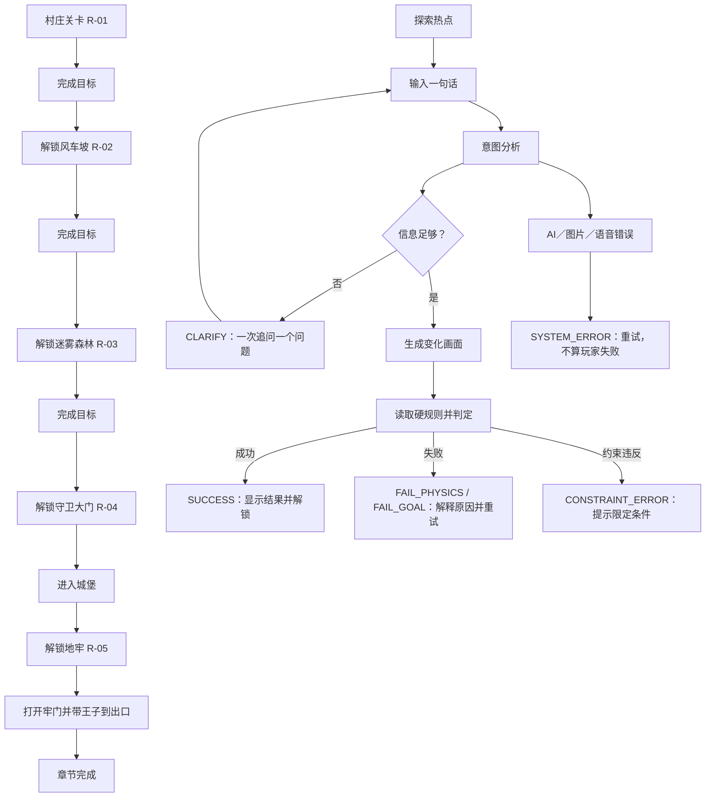
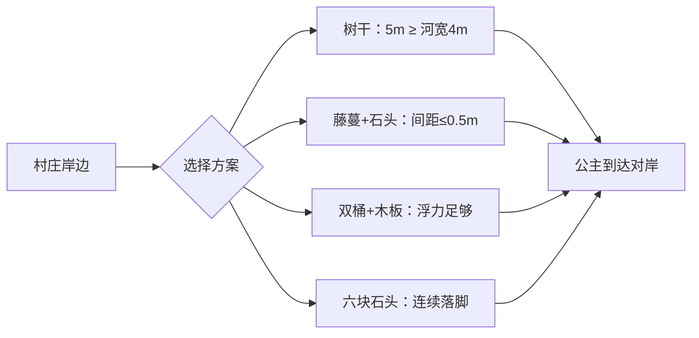

# 公主邪恶城堡救王子｜关卡设计 PRD

版本：0.1  
状态：草案，待关卡原型与儿童可玩性测试  
适用范围：AI 儿童创造解谜 MVP 的桌面端 Web 体验  
工作文件夹：D:\All\Project\AI\AI 儿童创造解谜

资料依据：

- 《游戏设计.md》（本项目现有游戏设计 PRD，2026-10-11 读取）。本文沿用其中的关卡状态、热点探索、自然语言输入、AI 意图分析、图片变化、物理判定、追问和成功／失败状态。
- [GitBook：How to write a game design document](https://www.gitbook.com/blog/how-to-write-a-game-design-document)：强调 GDD 是团队共同依据，应保持简洁、可搜索、可持续更新，并从目标、核心循环、规则、内容、界面逐层展开。
- [Game Design Skills：How to Make a Good Game Design Document](https://gamedesignskills.com/game-design/make-game-design-document/)：强调按目标、问题、备选方案、优先级组织功能文档，以短文档和视觉化结构服务程序、美术与 QA。
- [The Level Design Book](https://book.leveldesignbook.com/process/release)：强调关卡布局、流程和标注应能被复盘与验证。
- [Reddit r/leveldesign：Level design document](https://www.reddit.com/r/leveldesign/comments/hdbm2u/level_design_document/)：作者经验认为关卡文档应随着可玩原型调整，纸面上成立的方案仍需实际试玩检验。
- [Indie Hackers：A post-mortem of our mobile indie game studio](https://www.indiehackers.com/post/a-post-mortem-of-our-mobile-indie-game-studio-included-bb999ac9f3)：独立开发复盘强调记录决定、范围和结果，帮助小团队持续取舍。
- [Indie Hackers：How a Hobbyist Game Developer Launched a Game](https://www.indiehackers.com/post/how-a-hobbyist-game-developer-launched-a-game-that-generates-2-500-mo-pfGheRjkxLIdF72DkHFt)：独立开发者案例体现小团队应围绕核心体验迭代，避免把文档和功能范围无限扩大。
- 已尝试检索 Reddit 的 r/indiehackers 与 r/microsaas。部分页面受 robots.txt、缓存或检索结果限制，未将无法直接核验的帖子当作事实；可用经验仅作为“小团队控制范围、持续复盘”的旁证，不作为本关卡规则依据。

关键待确认：

- 关卡美术是否采用统一的“黑色童话但不恐怖”色彩与角色形象；影响美术资源清单，不影响本 PRD 的规则。
- AI 物理判定服务的置信度阈值、图片生成失败重试上限和具体响应时延；影响工程验收参数，需由 AI／客户端确认。
- “王子被困”是否需要加入家长可见的叙事提示；影响文案层级，不影响玩法。

## 第一章 需求概述

### 1.1 需求背景

#### 1.1.1 背景材料

现有《游戏设计.md》将产品定义为：儿童观察 2D 场景，探索物体事实，用一句自然语言提出方案，再由 AI 生成变化画面、解释物理原因并判断是否成功。关卡必须有一个可判断目标、最多三个限定条件、3–8 个可探索元素、可配置的关键物理事实，以及成功、失败、追问和系统错误状态。

本需求把这套通用机制落到一个连续故事：公主从村庄出发，经过三段旅途，绕过城堡守卫，进入城堡救出王子。关卡设计文档采用“目标—场景—规则—分支—验收”的结构，原因是程序需要将规则配置化，美术需要知道哪些物体必须出现，QA 需要能复现每个成功和失败分支。

#### 1.1.2 问题来源与影响

如果只写“公主想办法救王子”，玩家和研发都需要自行猜测目标、可用物体和成功条件，AI 也容易凭空补充道具或把故事上合理的方案判为成功。本关卡组需要把每个场景中的事实、动作和目标写成可以被儿童理解、被 AI 解释、被程序验收的规则。

本需求的核心设计取舍：

- 每关只有一个主目标，降低儿童的理解负担。
- 每关最多三个限定条件，避免玩家把注意力放在格式而不是探索。
- 每关至少三个可验证解法，鼓励表达差异。
- 解法由不同物体组合或不同物理路径组成，不把“换一句近义话”重复计算为新解法。
- 失败解释指出具体变量，例如长度、承重、支撑点、视线或触发力度。

### 1.2 需求目标

- 目标 G-01：完成一条从村庄到城堡、再到地牢的五关连续旅程，关卡顺序清晰，完成当前关后解锁下一关。
- 目标 G-02：全关卡至少配置 18 条可成立的通关方法，覆盖搭桥、漂浮、攀爬、导航、伪装、绕行、工具延伸和磁力取物等不同思路；其中每关至少 3 条。
- 目标 G-03：每条成功方法都能由场景热点提供所需事实，并能由硬规则判断；每条常见失败方法都有具体原因。
- 目标 G-04：儿童可以用一句自然语言描述方案；信息不足时 AI 最多追问两次，不因图片生成失败被判定为玩家失败。
- 目标 G-05：在不实现实时物理引擎的前提下，关卡配置可被客户端、AI 编排和 QA 复用。

衡量方式：

- 关卡验收：R-01 至 R-05 的目标、约束、热点、成功分支、失败分支和状态流转全部通过验收。
- 解法覆盖：M-01 至 M-18 共 18 条方案逐条输入，均得到 `SUCCESS`；同一关至少再配置 1 条 `FAIL_PHYSICS` 或 `FAIL_GOAL`。
- 规则可解释性：每次成功或失败解说至少指出一个实际参与判定的变量。
- 数据口径：沿用现有 `level_open`、`input_submit`、`judgement_result`、`level_success` 等事件；新增事件名和字段见各关 2.x.6。
- 基线与数值目标：当前没有真实玩家基线，以上为本次内容验收目标，不代表上线后的留存或完成率承诺。
- 护栏：系统错误不得计入玩家失败；图片变化不得增加场景中不存在的关键物体；未探索信息不能成为唯一成功前提。

### 1.3 需求概述

#### 1.3.1 需求列表与优先级

优先级暂按“影响主流程且无替代路径的内容为 P0；影响表现但可延后优化的内容为 P1”。

| 编号 | 需求 | 关联目标 | 优先级与理由 | 本期交付边界 |
| --- | --- | --- | --- | --- |
| R-01 | 村庄到河对岸 | G-01、G-02、G-03 | P0；建立物体组合与基础物理规则 | 1 个过河场景、4 条成功方法、至少 2 条失败方法 |
| R-02 | 风车坡断路 | G-01、G-02、G-03 | P0；引入高度、支撑和跨距 | 1 个断路场景、3 条成功方法、至少 2 条失败方法 |
| R-03 | 迷雾森林找后门 | G-01、G-02、G-03 | P0；引入观察、试探和路线选择 | 1 个三岔路场景、4 条成功方法、至少 2 条失败方法 |
| R-04 | 城堡门口守卫 | G-01、G-02、G-03 | P0；引入社会线索、视线和绕行 | 1 个守卫场景、3 条成功方法、至少 2 条失败方法 |
| R-05 | 地牢救王子 | G-01、G-02、G-03 | P0；综合工具延伸、磁力和协作 | 1 个牢房场景、4 条成功方法、至少 2 条失败方法 |
| R-06 | 全局状态与解法记录 | G-03、G-04、G-05 | P0；保证每关可追问、可重试、可解锁 | 沿用现有状态机，不新增实时物理引擎 |

#### 1.3.2 需求范围

本期包含：

- 五个连续关卡及其开场白、目标、限定条件、场景物体、热点事实和规则配置。
- 鼠标／语音输入一句自然语言，AI 识别物体、动作、用途和目标。
- 成功、物理失败、目标失败、信息不足、约束错误和系统错误状态。
- 18 条明确成功方案及可复现的输入示例。
- 各关的场景布局说明、关键物理数值、成功／失败验收、埋点和配置示例。
- 完成关卡后解锁下一关；已完成关卡可以重玩。

本期不包含：

- 实时角色移动、拖拽物体或自由绘图。
- 战斗、伤害、武器、恐怖表现或对守卫造成伤害。
- 玩家凭空创造关键道具、改变河流／城堡结构或编辑地图。
- 多人联机、背包、货币、排行榜、养成系统。
- 具体模型、数据库、中间件、部署架构和美术最终稿。

角色与系统：

- 玩家：扮演公主，用一句话提出行动方案。
- AI 意图分析：把自然语言映射为已配置的物体、动作、角色和目标。
- AI 图片生成：只呈现方案导致的场景变化，不负责最终物理裁决。
- 物理判定：读取关卡配置，按硬规则判断是否成立。
- 客户端：展示热点、输入、处理中、结果和解锁。
- QA：按本文验收示例复现主路径与失败路径。

#### 1.3.3 系统现状

现有系统已定义 `LEVEL_INTRO → LEVEL_READY → INPUT_EDITING → ANALYZING → RENDERING → JUDGING`，并从判定进入 `SUCCESS`、`FAIL` 或 `CLARIFY`。系统错误独立处理，不算玩家失败。

现有能力中已确认的共性规则：

- 每个关键物体必须有热点，热点浮框只显示事实，不直接显示答案。
- 输入建议为 3–80 个汉字，空输入不调用 AI。
- AI 先标准化输入，再识别意图，再生成变化画面和解说，最后按硬规则判定。
- 规则不足时一次只追问一个最关键的问题，连续追问最多两次。
- 图片生成必须保留未涉及元素，不得凭空增加关键道具。
- 成功必须同时满足物理规则、目标条件和本关限定条件。

本关卡组当前没有既有线上关卡逻辑；具体数字和状态以本 PRD 的关卡配置为准，待原型后通过试玩修正。

#### 1.3.4 目标状态

玩家看到一条由五张关卡卡片组成的故事路线：

1. 村庄河边：学会用已有物体跨越障碍。
2. 风车坡：理解长度、支撑和承重。
3. 迷雾森林：通过可观察线索寻找安全路线。
4. 城堡门口：在不伤害守卫、不触发警报的前提下进入。
5. 地牢牢房：组合延伸工具或利用磁力打开牢门，带王子离开。

每关的完整链路是：开场白说明人物与目标 → 玩家探索热点 → 玩家输入方案 → AI 解释理解 → 场景图变化 → 物理判定 → 解释结果 → 成功解锁／失败重试／追问补充。

#### 1.3.5 业务／功能流程图



读图说明：P–AA 是每一关共用的单关循环；A–K 是五关解锁顺序。`SUCCESS` 只有在目标、硬规则和约束同时成立时触发，图片本身不能绕过 V 的规则判定。

#### 1.3.6 解法覆盖与自模拟清单

以下 18 条方案是设计阶段按关卡配置逐条模拟的成功路径。它们使用不同物体组合或不同物理机制；仅替换近义词不单独计数。

| 方法编号 | 关卡 | 玩家输入示例 | 主要判定机制 |
| --- | --- | --- | --- |
| M-01 | R-01 | “把倒下的树推到河上当桥走过去。” | 5 米树干跨过 4 米河面，两端各有支撑 |
| M-02 | R-01 | “把藤蔓系在两根木桩上，沿着石头走过河。” | 藤蔓作扶手，石头间距不超过 0.5 米 |
| M-03 | R-01 | “把两个空桶用藤蔓绑在木板下面，坐在木板上划到对岸。” | 双桶浮力总和 160 千克，大于公主与木板总重 |
| M-04 | R-01 | “把六块石头排成一条路，踩着石头过河。” | 每一步稳定，最后一块距对岸不超过 0.5 米 |
| M-05 | R-02 | “把长木板横放在断路两边，当成桥。” | 木板 4 米，断路 3 米，两端支撑各不少于 0.5 米 |
| M-06 | R-02 | “把三捆干草首尾相连铺在断路上。” | 三捆干草总长 3.6 米，压实后可承受 35 千克 |
| M-07 | R-02 | “把绳子系在风车轴和对面大树上，坐进篮子滑过去。” | 绳长 8 米、承重 60 千克，两端固定，篮子承重 50 千克 |
| M-08 | R-03 | “跟着不靠近沼泽的萤火虫走到城堡后门。” | 萤火虫聚集路线是安全土路 |
| M-09 | R-03 | “提着灯照白色石标，踩着石头过小溪再走后门。” | 灯光可照出反光石标，石块间距不超过 0.4 米 |
| M-10 | R-03 | “用木棍逐段试探地面，遇到硬地就用粉笔画记号再往前走。” | 木棍长 1.5 米可探出沼泽，硬地反馈稳定阻力 |
| M-11 | R-03 | “把绳子一端系在入口，沿每条路试探，找到硬地路线后拉着绳子回来。” | 绳长 6 米足够覆盖首个分叉，标记防止迷路 |
| M-12 | R-04 | “披上送信斗篷，拿着盖章卷轴请守卫开门。” | 斗篷与卷轴满足守卫的送信检查条件 |
| M-13 | R-04 | “躲进送草车的遮布下面，让车停在门内再出来。” | 车侧遮布阻挡正面视线，守卫只检查车头和卷轴 |
| M-14 | R-04 | “把细绳系在侧门插销上，趁守卫看公告时从墙后拉开侧门。” | 侧门插销需 15 牛顿，警铃绳需超过 20 牛顿才触发 |
| M-15 | R-05 | “站到木凳上，用扫帚钩下牢门外的钥匙。” | 木凳增加 0.4 米高度，扫帚与身高合计够到 2.1 米钥匙 |
| M-16 | R-05 | “把围巾系在扫帚上加长，再从栏杆外把钥匙勾过来。” | 围巾与扫帚形成 3 米延伸杆，钥匙距栏杆 0.6 米 |
| M-17 | R-05 | “用马蹄磁铁隔着栏杆把铁钥匙吸到手边。” | 磁铁有效距离 0.5 米，钥匙距栏杆 0.4 米 |
| M-18 | R-05 | “把绳子穿过栏杆，让王子把绳子套到里面的拉杆上，我们一起拉开。” | 栏杆间隙可穿绳，拉杆需 25 牛顿，公主与王子合力可达 40 牛顿 |

自模拟结论：M-01 至 M-18 均能在本文给定的长度、承重、视线、力度和路线条件下成立；每关至少有三条不依赖同一核心物体的成功路径。正式上线前仍需用儿童试玩验证“玩家是否能从热点事实推导出方法”，不能把策划自模拟当作真实玩家可发现性的证明。

## 第二章 需求详述

### 2.1 村庄河边：踏上旅途

需求编号：R-01

#### 2.1.1 村庄河边需求范围

- 适用角色与权限：玩家扮演公主；无注册即可进入第一关。
- 入口与场景：故事书首页 → 关卡选择 → 第一关开场白。
- 玩家目标：让公主安全到达河对岸的城堡方向道路。
- 限定条件：只使用场景已有物体；不能改变河流宽度和水流方向；用一句话描述。
- 排除项：不能游泳、不能凭空生成桥、不能把河流填平、不能伤害动物或村民。
- 成功条件：公主的脚或所乘载具到达对岸稳定地面，支撑在判定时保持成立。

#### 2.1.2 村庄河边系统现状

本关没有既有线上逻辑，按《游戏设计.md》共性状态机从 `LEVEL_INTRO` 开始。场景配置需新增河流、木桩、树干、藤蔓、石头、木板和空桶；每个参与判定的对象都必须有热点。

#### 2.1.3 村庄河边新增逻辑与推全后的线上整合逻辑

##### 2.1.3.1 本次新增／变更逻辑

**B-01 树干桥**

- 前置条件与触发：玩家描述推倒／搬动树干并把它放到河面。
- 输入与校验：识别 `log_01`、动作 `move/place`、用途 `bridge`。
- 判断与执行：树干可用长度 5 米；河宽 4 米；两端落在稳定岸地且各有至少 0.5 米支撑时成功。
- 输出与状态：生成树干横跨河面的画面，公主走过，进入 `SUCCESS`。
- 失败：只说“砍树当桥”但没有说明放置位置时 `CLARIFY`；树干落在水中未接触两岸时 `FAIL_PHYSICS`。

**B-02 藤蔓扶手与石路**

- 前置条件与触发：玩家使用藤蔓固定木桩，并排列石头。
- 判断与执行：藤蔓长 8 米、承重 60 千克；石头可移动但单块不可漂浮；相邻落脚点间距不超过 0.5 米。
- 输出与状态：显示藤蔓拉紧、石头成为连续落脚点，公主扶着藤蔓走过。
- 失败：只系一端、石头间距超过 0.5 米或把藤蔓当成独立悬桥时 `FAIL_PHYSICS`。

**B-03 双桶木板筏**

- 前置条件与触发：玩家把两只空桶绑在木板下方，并说明乘坐／划到对岸。
- 判断与执行：两只空桶总浮力 160 千克；公主、木板和少量行李总重不超过 70 千克；藤蔓固定后木板保持水平。
- 输出与状态：显示木筏漂浮并沿缓流到达对岸。
- 失败：只使用一只桶、未固定木板或让木板直接漂浮时 `FAIL_PHYSICS`。

**B-04 石头跳跃**

- 前置条件与触发：玩家把六块石头排成连续路线。
- 判断与执行：每块石头固定性足以承受 70 千克，落脚间距不超过 0.5 米，最后一块接近对岸。
- 输出与状态：公主逐块踩过，抵达对岸。
- 失败：石头数量不足以形成连续落脚点时 `FAIL_GOAL`。

##### 2.1.3.2 推全后的线上整合逻辑

1. 入口与适用判断：第一关默认解锁；只有进入本关场景后才读取本关配置。
2. 完整执行链路：探索热点 → 输入方案 → 识别对象与动作 → 检查三条约束 → 按 B-01 至 B-04 及组合规则判定 → 生成变化画面与解说 → 成功解锁 R-02。
3. 存量兼容：当前无存量关卡数据；重玩本关重新生成尝试，不覆盖首次完成状态。
4. 最终结果：成功显示“河对岸到了！”并提供“继续前往风车坡”；失败保留输入和场景，允许重新描述；系统错误可重试且不计失败。

##### 2.1.3.3 过渡安排

不适用。本关为全新内容，不需要灰度或旧客户端兼容。

##### 2.1.3.4 验收示例

**AC-01，关联 R-01／B-01：树干桥成功**

- 给定：河宽 4 米，树干可用长度 5 米，两岸均为稳定地面。
- 当：输入“把倒下的树推到河上当桥走过去”。
- 则：识别树干和桥用途，生成树干两端接地的画面，判定 `SUCCESS`，解锁 R-02。

**AC-02，关联 R-01／B-03：不稳定木筏失败**

- 给定：玩家只提到一只空桶和木板。
- 当：输入“坐在一只桶和木板上漂过去”。
- 则：判定浮力和稳定性不足，状态为 `FAIL_PHYSICS`，解释“一个桶不能让木板保持稳定”，不解锁下一关。

**AC-03，关联 R-01／共性追问：对象不清**

- 给定：场景中有树干、藤蔓和石头。
- 当：输入“把它弄过去”。
- 则：只追问“你想用哪个物体，让谁到河对岸？”，不生成图片，不改变状态。

#### 2.1.4 村庄河边示意图与实现说明



场景元素与热点事实：

| ID | 名称 | 可观察事实 | 可改变动作 |
| --- | --- | --- | --- |
| river_01 | 河流 | 宽 4 米，水深 0.4 米，水流缓慢，方向固定 | 不能改变宽度和方向 |
| log_01 | 倒木 | 长 5 米，可推动，不能漂浮 | 可搬动、横放 |
| vine_01 | 藤蔓 | 长 8 米，承重 60 千克，可打结 | 可系在固定木桩 |
| stone_01–06 | 石头 | 每块可承重 70 千克，不能漂浮 | 可排列 |
| board_01 | 木板 | 长 2 米，可作筏面 | 可与桶绑在一起 |
| barrel_01–02 | 空桶 | 每只浮力 80 千克 | 可绑在木板下 |
| post_left/right | 木桩 | 固定在岸边 | 可作为绑缚点 |
| princess | 公主 | 体重 35 千克，不能独自游过河 | 可走、乘坐载具 |

#### 2.1.5 村庄河边工程要求

- 数据流依赖：关卡配置 → AI 意图对象映射 → 规则判定 → 场景变化提示 → 结果页；`river_01` 的宽度和所有承重数字必须只来自配置。
- 数据存储时效性：保存本次输入、解析结果、判定结果和完成状态；重玩尝试可保留为历史记录，完成状态只从未完成变为已完成，不因失败回退。
- 数据延迟：操作反馈和空输入校验即时；AI 分析、图片生成和判定沿用全局服务约定，具体阈值待 AI／客户端确认；超时进入 `SYSTEM_ERROR`。
- 可控性：策划可配置河宽、物体尺寸、承重、可用动作和成功条件；关闭本关时关卡卡片显示暂不可用，不删除历史完成状态。
- 可扩展性：允许后续增加“木板+藤蔓”等组合规则；不要求实时物理引擎。

#### 2.1.6 村庄河边数据埋点

分析问题：儿童是否先探索物体，是否理解“长度／浮力／间距”，以及哪种解法最常被尝试。

- `level_element_inspected`，关联 R-01：热点停留超过 300ms 时上报，每个对象每次进入关卡最多一次；字段 `level_id`、`element_id`、`fact_group`。
- `level_solution_branch`，关联 R-01／G-02：判定完成后由规则侧上报一次；字段 `method_id`、`result`、`attempt_id`、`reason_code`。
- 沿用 `judgement_result` 和 `level_success`；不保存原始音频，文本按现有数据边界处理。

### 2.2 风车坡断路：跨过高度差

需求编号：R-02

#### 2.2.1 风车坡断路需求范围

- 玩家目标：跨过风车坡上的 3 米断路，到达对面高地。
- 限定条件：只使用已有物体；不能拆掉风车主体或改变断路位置；用一句话描述。
- 场景核心：引入高度差、支撑和承重。
- 排除项：不能飞行、不能凭空造桥、不能让绳子无固定点悬空。

#### 2.2.2 风车坡断路系统现状

本关为新增场景，沿用 R-01 的输入、热点、判定和解锁逻辑。客户端需要支持高度差和两个固定端点的图像表现。

#### 2.2.3 风车坡断路新增逻辑与推全后的线上整合逻辑

##### 2.2.3.1 本次新增／变更逻辑

**B-05 木板桥**

- 断路宽 3 米；木板长 4 米；两端各有至少 0.5 米稳定支撑时成功。
- 只把木板竖放、只放在一侧或缺少支撑时 `FAIL_PHYSICS`。

**B-06 干草桥**

- 三捆干草每捆长 1.2 米、宽 0.8 米、压实后可承重 35 千克；首尾相连总长 3.6 米。
- 干草必须放平且接触两侧地面；只堆在一侧作为台阶时未达成跨路目标。

**B-07 绳索滑篮**

- 风车轴和对面大树是固定点；绳长 8 米、承重 60 千克；篮子承重 50 千克。
- 玩家必须说明绳索两端固定和乘坐篮子；只说“用绳子荡过去”且无固定点时 `CLARIFY` 或 `FAIL_PHYSICS`。

##### 2.2.3.2 推全后的线上整合逻辑

1. 玩家完成 R-01 后解锁本关。
2. 系统检查输入是否涉及断路、风车轴、大树、木板、干草、绳子或篮子。
3. 先检查约束，再检查跨度与承重，最后检查公主是否到达高地。
4. 成功进入 R-03；失败保留尝试并解释缺少的支撑、长度或承重。

##### 2.2.3.3 过渡安排

不适用。没有旧版本关卡数据。

##### 2.2.3.4 验收示例

**AC-04，关联 R-02／B-05：木板跨路**

- 给定：断路 3 米，木板 4 米，两侧可支撑。
- 当：输入“把长木板横放在断路两边，当成桥”。
- 则：木板两端接触高地，状态为 `SUCCESS`。

**AC-05，关联 R-02／B-07：无锚点失败**

- 给定：玩家只提到 8 米绳子，不提风车轴或大树。
- 当：输入“用绳子荡到对面”。
- 则：追问固定在哪里；若两次仍无固定点，状态为 `FAIL_PHYSICS`，解释“绳子没有支撑点”。

#### 2.2.4 风车坡断路示意图与实现说明

| ID | 名称 | 可观察事实 | 可改变动作 |
| --- | --- | --- | --- |
| gap_01 | 断路 | 宽 3 米，远端高 1 米，位置固定 | 不能改变位置 |
| plank_01 | 长木板 | 长 4 米，可承重 70 千克 | 可搬动、横放 |
| hay_01–03 | 干草捆 | 每捆长 1.2 米，压实后承重 35 千克 | 可搬动、首尾连接 |
| rope_02 | 粗绳 | 长 8 米，承重 60 千克 | 可系在固定点 |
| windmill_axle | 风车轴 | 固定，高 4 米，可作为锚点 | 不可拆除 |
| tree_anchor | 对面大树 | 固定，可承受 100 千克拉力 | 可绑绳 |
| basket_01 | 滑篮 | 承重 50 千克 | 可挂在绳上 |
| princess | 公主 | 体重 35 千克 | 可走、乘篮 |

#### 2.2.5 风车坡断路工程要求

- 所有跨度、支撑和承重判断读取同一关卡配置，不能由图片模型自行估算。
- 失败原因至少返回 `SPAN_TOO_SHORT`、`NO_SUPPORT`、`LOAD_TOO_HIGH` 或 `NO_ANCHOR` 之一。
- 若规则组合需要先绑绳再放篮子，意图解析应保留动作顺序；顺序缺失但结果唯一时可按软规则补全，存在两种结果时追问。
- 关卡配置允许调节断路宽度和物体尺寸，用于儿童试玩难度调整。

#### 2.2.6 风车坡断路数据埋点

- `level_solution_branch` 记录 `method_id=M-05/M-06/M-07`、成功或失败原因。
- `physics_fact_viewed` 记录玩家是否查看 `gap_01`、`plank_01`、`rope_02` 的长度／承重事实。
- 目标是比较“看过事实后成功”和“未看事实直接尝试”，不把查看行为当成成功本身。

### 2.3 迷雾森林找后门：用线索选路

需求编号：R-03

#### 2.3.1 迷雾森林找后门需求范围

- 玩家目标：通过迷雾森林，抵达城堡后门，不踏入沼泽。
- 限定条件：只能使用场景已有物体；不能砍倒整片森林；用一句话描述。
- 场景核心：同一目标存在观察线索、试探路线和标记路线。
- 排除项：不能瞬移、不能凭空点亮全森林、不能把沼泽当作可承重地面。

#### 2.3.2 迷雾森林系统现状

本关为新增导航型场景。AI 需要识别“跟随、照亮、试探、标记、系住”等动作，并把路线选择映射到安全路径配置。

#### 2.3.3 迷雾森林新增逻辑与推全后的线上整合逻辑

##### 2.3.3.1 本次新增／变更逻辑

**B-08 萤火虫安全路**

- 萤火虫只聚集在硬土地面，不会停在沼泽上；跟随萤火虫可到后门。
- 仅说“抓住萤火虫照明”不达成目标，且会触发“不要伤害萤火虫”的约束提示。

**B-09 灯与白石标记**

- 灯照明半径 6 米；白石在灯光下反光，沿小溪布置，石块间距不超过 0.4 米。
- 玩家照亮白石并沿石路过溪后可到后门。

**B-10 木棍试探与粉笔标记**

- 木棍长 1.5 米；沼泽深 0.8 米，插入后无稳定阻力；硬地会返回稳定阻力。
- 玩家逐段试探并用粉笔标记安全路线，可避开沼泽。

**B-11 绳索回路**

- 绳长 6 米，系在入口树桩；玩家可沿分叉试探，找到安全路后沿绳返回并选择已确认路线。
- 绳索只能防止迷路，不能单独跨越沼泽。

##### 2.3.3.2 推全后的线上整合逻辑

1. 进入场景后展示三条可见分叉，但不直接标出答案。
2. 玩家探索萤火虫、灯、白石、木棍、粉笔和绳索的事实。
3. AI 先判断玩家选择的是“线索跟随”“石路过溪”还是“试探标记”。
4. 只要路线最终到达后门且没有进入沼泽，均判定成功。
5. 走入沼泽、没有足够照明或用绳子直接把自己吊过整片森林时，按具体原因失败。

##### 2.3.3.3 过渡安排

不适用。

##### 2.3.3.4 验收示例

**AC-06，关联 R-03／B-08：萤火虫路线**

- 当：输入“跟着不靠近沼泽的萤火虫走到城堡后门”。
- 则：识别萤火虫为路线线索，生成沿硬地前进的画面，状态为 `SUCCESS`。

**AC-07，关联 R-03／B-10：错误试探**

- 当：输入“用木棍探路，直接踩进最短的泥地”。
- 则：判定踩入 0.8 米沼泽，状态为 `FAIL_PHYSICS`，解释木棍已显示地面没有稳定阻力。

#### 2.3.4 迷雾森林示意图与实现说明

| ID | 名称 | 可观察事实 | 可改变动作 |
| --- | --- | --- | --- |
| path_swamp | 沼泽路 | 深 0.8 米，不能承受公主 | 可用木棍试探，不能直接通过 |
| path_firm | 硬土地 | 可承重，萤火虫会聚集 | 可行走 |
| stream_path | 小溪石路 | 石块间距 0.4 米以内 | 可照亮、踩踏 |
| fireflies | 萤火虫 | 只停在硬地，不能被当作道具抓走 | 可跟随 |
| lantern_03 | 提灯 | 照明半径 6 米 | 可照明反光石 |
| chalk_03 | 粉笔 | 可在树上留下可见标记 | 可标路 |
| probe_stick | 木棍 | 长 1.5 米，可反馈地面阻力 | 可试探地面 |
| rope_03 | 绳索 | 长 6 米，可系在入口树桩 | 可防止迷路 |
| back_gate | 城堡后门 | 位于安全路线终点 | 可作为目标终点 |

#### 2.3.5 迷雾森林工程要求

- 路线判定不是图片识别：配置中明确每条路径的安全状态、长度和终点。
- 同一输入可能先探索再行动；若玩家明确描述“试探后选择硬地”，判定应保留先后顺序。
- 追问示例：“你想跟着哪条线索走，还是先用木棍试探地面？”
- 美术必须让三条路线视觉上可区分，但不能在未探索时直接用箭头标出答案。

#### 2.3.6 迷雾森林数据埋点

- `route_clue_inspected`：记录 `fireflies`、`lantern_03`、`probe_stick`、`rope_03` 等线索探索。
- `route_choice_result`：记录选择的路径类型、是否踩入沼泽、是否到达 `back_gate`。
- 目标是判断玩家是否理解“事实线索 → 路线选择”，不采集与目标无关的语音原始内容。

### 2.4 城堡门口守卫：不触发警报进入

需求编号：R-04

#### 2.4.1 城堡门口守卫需求范围

- 玩家目标：在不伤害守卫、不触发警铃的情况下进入城堡。
- 限定条件：不能攻击或捆绑守卫；不能破坏城门；用一句话描述。
- 场景核心：伪装与凭证、遮挡视线、侧门绕行三类方法。
- 排除项：不能让守卫受伤、不能拉响主警铃、不能凭空生成身份物品。

#### 2.4.2 城堡门口守卫系统现状

本关为新增角色互动场景。守卫的视线、检查条件、警铃触发力度和侧门插销必须配置化，不能由语言模型自行推断。

#### 2.4.3 城堡门口守卫新增逻辑与推全后的线上整合逻辑

##### 2.4.3.1 本次新增／变更逻辑

**B-12 送信伪装**

- 斗篷是城堡信使制服；盖章卷轴是守卫认可的凭证。
- 同时描述披上斗篷并出示卷轴，守卫会打开小门，警铃不触发。

**B-13 送草车遮挡**

- 送草车侧面遮布不透明，守卫只从车头和上方检查；玩家藏在遮布下可随车进入。
- 若玩家描述破坏遮布或撞倒守卫，触发约束错误，不进入成功。

**B-14 侧门插销绕行**

- 侧门插销需要 15 牛顿；主警铃绳被拉动超过 20 牛顿才触发警报。
- 玩家用细绳绕过墙角系在侧门插销上，并在守卫查看公告时轻拉，可无声打开侧门。

##### 2.4.3.2 推全后的线上整合逻辑

1. 只有完成 R-03 才解锁守卫关卡。
2. 进入场景后守卫面向主门，公告栏和侧门处于可探索状态。
3. 先检查“伤害／破坏／警铃触发”约束，再判断凭证、视线和拉力。
4. 成功后进入城堡庭院并解锁 R-05；失败时守卫保持原位，玩家可重新描述。

##### 2.4.3.3 过渡安排

不适用。

##### 2.4.3.4 验收示例

**AC-08，关联 R-04／B-12：凭证进入**

- 当：输入“披上送信斗篷，拿着盖章卷轴请守卫开门”。
- 则：守卫检查凭证并打开小门，状态为 `SUCCESS`，不触发警铃。

**AC-09，关联 R-04／B-14：拉力过大**

- 当：输入“猛拉警铃绳让守卫跑开，再冲进城堡”。
- 则：警铃绳超过 20 牛顿，状态为 `CONSTRAINT_ERROR` 或 `FAIL_GOAL`，解释不能触发警报。

#### 2.4.4 城堡门口守卫示意图与实现说明

| ID | 名称 | 可观察事实 | 可改变动作 |
| --- | --- | --- | --- |
| guard | 守卫 | 面向主门，视线约 120°，不伤害玩家 | 可交谈、检查凭证 |
| cloak | 信使斗篷 | 城堡信使制服 | 可穿戴 |
| scroll | 盖章卷轴 | 守卫认可的送信凭证 | 可出示 |
| hay_cart | 送草车 | 侧面遮布不透明，可推动 50 千克 | 可推、可藏 |
| bell_rope | 主警铃绳 | 拉力超过 20 牛顿会报警 | 可触碰，但不能超过阈值 |
| side_latch | 侧门插销 | 需要 15 牛顿拉力 | 可用细绳拉动 |
| thin_rope | 细绳 | 长 5 米，可传递不超过 18 牛顿的拉力 | 可系插销 |
| notice_board | 公告栏 | 守卫查看时背向侧墙 | 可作为视线时机 |
| side_gate | 侧门 | 目标入口，打开后进入庭院 | 可开启 |

#### 2.4.5 城堡门口守卫工程要求

- 角色互动的成功条件必须由状态变量表示：`guard_alert=false`、`gate_open=true`、`player_inside=true`。
- AI 识别“伪装”“出示”“藏在”“绕到后面”等软规则时，仍需映射到已配置对象。
- 生成图不得把守卫画成受伤、昏迷或被捆绑；这些属于约束违规。
- 失败解释优先指出警铃阈值、凭证缺失、视线暴露或侧门拉力不足。

#### 2.4.6 城堡门口守卫数据埋点

- `guard_interaction_attempt`：记录凭证、遮挡、侧门三类意图及 `guard_alert` 状态。
- `constraint_violation`：记录攻击、破坏、触发警报等原因码。
- `level_success`：仅在守卫未报警且玩家进入庭院时上报成功。

### 2.5 地牢救王子：打开牢门并离开

需求编号：R-05

#### 2.5.1 地牢救王子需求范围

- 玩家目标：打开牢门，让王子走出牢房并到达地牢出口。
- 限定条件：不能破坏承重墙；不能伤害王子或自己；只使用牢房和走廊已有物体。
- 场景核心：高度补偿、工具延伸、磁力取物、双人协作。
- 排除项：不能凭空生成钥匙、炸开牢门或让王子穿过实心墙。

#### 2.5.2 地牢救王子系统现状

本关为五关终点，沿用全局结果页。完成后将章节状态设为 `CHAPTER_COMPLETE`，不再解锁其他关卡。

#### 2.5.3 地牢救王子新增逻辑与推全后的线上整合逻辑

##### 2.5.3.1 本次新增／变更逻辑

**B-15 木凳加扫帚取钥匙**

- 钥匙悬挂高度 2.1 米；扫帚长 1.8 米；木凳高 0.4 米且可稳定承重。
- 公主站在木凳上用扫帚钩钥匙，取下后打开牢门。

**B-16 围巾延长扫帚**

- 围巾长 1.2 米，可与扫帚连接形成约 3 米的延伸工具；结点需固定。
- 玩家必须描述系牢后再钩钥匙；只说“把围巾扔过去”不成立。

**B-17 马蹄磁铁取钥匙**

- 钥匙为铁制，距栏杆 0.4 米；磁铁有效距离 0.5 米。
- 磁铁可隔栏把钥匙吸到栏杆边，公主再取钥匙。

**B-18 绳索与王子协作拉杆**

- 牢门内有释放拉杆，高 1.7 米；绳索可穿过栏杆间隙；王子可把绳子套到拉杆上。
- 拉杆需要 25 牛顿，公主与王子合力上限 40 牛顿；一起拉动可打开牢门。

##### 2.5.3.2 推全后的线上整合逻辑

1. 完成 R-04 后解锁地牢。
2. 系统检查玩家是否使用已配置的工具、钥匙、磁铁、栏杆、绳索或王子。
3. 成功必须同时满足“牢门打开”“王子离开牢房”“两人到达出口”三个状态。
4. 只取到钥匙但没有让王子离开时为 `FAIL_GOAL`；系统错误不计失败。
5. 成功显示章节完成页，并提供重玩全部关卡的入口。

##### 2.5.3.3 过渡安排

不适用。章节完成状态只新增，不覆盖已完成历史。

##### 2.5.3.4 验收示例

**AC-10，关联 R-05／B-15：凳子取钥匙**

- 给定：木凳高 0.4 米、扫帚长 1.8 米、钥匙高 2.1 米。
- 当：输入“站到木凳上，用扫帚钩下牢门外的钥匙”。
- 则：钥匙被取下，牢门打开，王子到出口，状态为 `SUCCESS`。

**AC-11，关联 R-05／B-17：磁力取钥匙**

- 当：输入“用马蹄磁铁隔着栏杆把铁钥匙吸过来”。
- 则：识别钥匙为铁制且距离 0.4 米，状态为 `SUCCESS`。

**AC-12，关联 R-05／目标失败**

- 当：输入“把钥匙吸到手里”但没有打开牢门或带王子到出口。
- 则：状态为 `FAIL_GOAL`，解释“钥匙拿到了，还需要打开牢门并带王子离开”。

#### 2.5.4 地牢救王子示意图与实现说明

| ID | 名称 | 可观察事实 | 可改变动作 |
| --- | --- | --- | --- |
| cell_lock | 牢门锁 | 可用钥匙打开 | 不可徒手掰开 |
| key_05 | 铁钥匙 | 高 2.1 米，距栏杆 0.6 米，铁制 | 可钩、可磁吸 |
| broom_05 | 扫帚 | 长 1.8 米 | 可作为钩取工具 |
| scarf_05 | 围巾 | 长 1.2 米，可打结 | 可延长扫帚 |
| stool_05 | 木凳 | 高 0.4 米，稳定承重 70 千克 | 可垫高 |
| magnet_05 | 马蹄磁铁 | 有效距离 0.5 米 | 可吸铁钥匙 |
| rope_05 | 绳索 | 长 4 米，可穿过栏杆间隙 | 可套住拉杆 |
| bars_05 | 牢房栏杆 | 间隙可穿绳，不可让公主直接穿过 | 可作为绳索路径 |
| release_lever | 释放拉杆 | 牢门内高 1.7 米，需要 25 牛顿 | 可由王子套绳拉动 |
| prince | 王子 | 可走动，能与公主共同拉绳 | 可走出牢房 |
| exit_door | 地牢出口 | 牢门外 6 米，通向章节完成 | 作为最终目标 |

#### 2.5.5 地牢救王子工程要求

- 终点判定使用三个布尔状态：`cell_open`、`prince_out`、`both_at_exit`。
- 钥匙、磁铁、扫帚和绳索的距离、长度、材质、力度必须由配置提供。
- 若玩家输入“让王子帮忙”，但没有说明工具和动作，进入追问；若玩家说明王子把绳子套到拉杆上，则按 B-18 判定。
- 成功画面必须保留牢房、王子、公主和出口关系；不得直接跳到城堡外。

#### 2.5.6 地牢救王子数据埋点

- `rescue_method_attempt`：记录 `M-15` 至 `M-18`、关键工具和最终状态。
- `rescue_goal_progress`：记录 `cell_open`、`prince_out`、`both_at_exit` 三个状态的变化。
- `chapter_complete`：仅在三项状态均为真时上报一次；重复查看完成页不重复计数。

## 第三章 共性验收与配置契约

### 3.1 关卡配置最小结构

```json
{
  "id": "castle_rescue_01",
  "title": "村庄河边：踏上旅途",
  "chapter": 1,
  "intro": "公主来到村口，城堡方向的河流挡住了去路。",
  "goal": {
    "id": "princess_reaches_far_bank",
    "text": "让公主安全到达河对岸"
  },
  "constraints": [
    {"id": "existing_objects_only", "text": "只使用场景已有物体"},
    {"id": "fixed_river", "text": "不能改变河流宽度和方向"},
    {"id": "one_sentence", "text": "用一句话描述"}
  ],
  "scene": {
    "aspect_ratio": "16:9",
    "background_asset": "village_river_001",
    "elements": [],
    "success_rules": [],
    "failure_rules": []
  },
  "solution_methods": ["M-01", "M-02", "M-03", "M-04"]
}
```

### 3.2 全局状态验收

- [ ] 五关按 R-01 → R-05 顺序解锁，第一关默认可玩。
- [ ] 失败、追问和系统错误不会解锁下一关。
- [ ] `SUCCESS` 必须同时满足目标、硬规则和限定条件。
- [ ] `CLARIFY` 一次只问一个问题，连续最多两次。
- [ ] 图片生成失败、语音识别失败和 AI 超时进入 `SYSTEM_ERROR`，不计入玩家失败。
- [ ] 每个关键物体有热点，热点事实与配置一致。
- [ ] 生成图不增加玩家未提到且配置中不存在的关键物体。
- [ ] 每关至少 3 个、最多 8 个可探索元素；装饰物不参与判定。
- [ ] 每关至少有 1 条常见错误输入及具体原因。
- [ ] M-01 至 M-18 逐条回放，全部得到成功结果；重放同一输入不会重复解锁。
- [ ] 试玩后若发现儿童无法从事实推导解法，应更新规则、热点文案或场景布局，并在版本记录中说明原因。

### 3.3 版本记录

| 版本 | 日期 | 修改内容 | 影响范围 |
| --- | --- | --- | --- |
| 0.1 | 2026-10-11 | 建立五关故事、18 条成功解法、物理规则、流程和验收 | R-01 至 R-06 |
