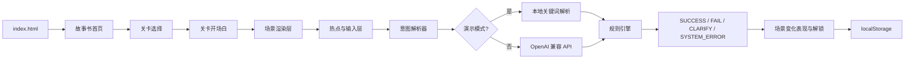

# AI 儿童创造解谜｜开发前技术方案

版本：0.1（2026-10-11）  
对应范围：`公主救王子`第一关可玩原型，兼容后续五关扩展

## 1. 已确认的产品约束

产品 PRD 要求五关按顺序解锁；玩家观察 2D 场景中的热点，用一句自然语言描述方案；AI 负责理解物体与动作，图片变化用于表现，最终成功或失败必须由可配置的硬规则判定。第一关的素材是 1672×941 的 16:9 绘本场景，背景和道具已经拆成透明 PNG，并提供了摆放坐标与锚点。

因此第一版先做“可验证的单关闭环”，而不是引入实时物理引擎或服务端。先验证儿童能否从热点事实想到方案，再扩展五关和更丰富的图像变化。

## 2. 技术选型

### 2.1 原生 HTML/CSS/JavaScript

页面必须能够复制到电脑后直接双击打开。React、Vite 等需要构建或开发服务器，会增加双击打开的阻力，所以当前原型使用原生 DOM、CSS 和浏览器 Fetch API，不引入第三方包。Python 3.12 只作为可选的本地静态服务器，解决某些浏览器对 `file://` 跨域请求的限制。

这种选择也便于美术调整：素材按 manifest 坐标绝对定位在 16:9 场景容器中，CSS 只负责响应式缩放，图片本身不被重新裁切。

### 2.3 页面状态与导航

页面按《游戏设计.md》的信息架构拆成四个可切换视图：故事书首页、关卡选择、黑底开场白、关卡场景。首页和选关页不依赖账号；第一关默认可挑战，完成后只把下一关从“未解锁”变为“可挑战”，失败和系统错误不改变解锁状态。已完成关卡保留“再玩一次”，新的尝试追加到本地历史，不覆盖完成状态。

开场白独立成黑底视图，每次只显示一段不超过 80 个汉字的文案；鼠标点击“继续”或按 Enter 进入下一段，最后一段才进入场景。这样不会把关卡目标、可用物体和答案挤在同一屏，也与产品要求的故事书节奏一致。

### 2.4 本地优先状态

游戏进度、已查看热点、输入历史和 AI 设置均保存在浏览器 localStorage。没有账号、数据库或云端游戏状态。API Key 仅由用户在本机输入并存储在当前浏览器；项目不包含密钥，也不会把 Key 写入 Git。

### 2.5 OpenAI 兼容 API 适配层

`src/app.js` 中的 `callAi()` 使用 `/v1/chat/completions` 风格请求，默认地址为 `https://api.openai.com/v1/chat/completions`，但设置面板允许改成其他 OpenAI 兼容服务。模型只返回结构化的意图候选：`methodId`、`entities`、`actions`、`missingInfo` 和 `confidence`。模型不可以直接返回 `SUCCESS`，也不可以修改关卡状态。

这样可以把“语言理解”和“游戏裁决”分开：模型出错时，规则引擎仍然能拒绝不存在的物体、缺少支撑的方案和违反限定条件的方案。

## 3. 运行结构



目录职责：

| 路径 | 职责 |
| --- | --- |
| `index.html` | 页面骨架与可访问性标签 |
| `styles.css` | 绘本视觉、响应式布局、结果状态 |
| `src/app.js` | 关卡配置、场景渲染、热点、AI 调用、规则判定、状态持久化 |
| `assets/scene` | 第一关背景、角色、道具和 manifest |
| `tools/start-local.ps1` | 可选的本地静态服务器 |
| `tools/check_project.py` | 不依赖第三方库的文件与素材尺寸检查 |

## 4. 第一关配置与规则边界

第一关采用 PRD 的 M-01 至 M-04 四条成功方法：树干桥、藤蔓与石路、双桶木板筏、连续石路。每条方法都以配置中的物体和数字为依据。当前原型的演示解析器用关键词模拟 AI，目的是在没有密钥时也能验收状态机；AI 模式只替换“识别”这一步。

规则顺序固定为：

1. 空输入与长度校验。
2. 约束校验：只能使用已存在物体、不能改变河流、必须一句话。
3. AI/演示解析：识别方法和涉及物体。
4. 关卡硬规则：长度、支撑、间距、浮力、固定关系。
5. 目标校验：公主到达对岸。
6. 记录尝试、展示解释，并在成功时解锁下一关。

图片只表现已判定的结果，不能改变规则。第一版用 CSS class 表现桥板落下、木筏出现和石路高亮；后续如果接入图像生成，生成图也必须被当成结果贴图而不是裁决来源。

## 5. AI API 接入契约

请求消息会包含当前关卡的目标、限定条件、热点事实和允许的方法 ID，并要求只返回 JSON，例如：

```json
{
  "methodId": "M-01",
  "entities": ["log_01", "river_01"],
  "actions": ["move", "place", "walk"],
  "missingInfo": [],
  "confidence": 0.94,
  "explanation": "玩家想把倒木横放在河面上当桥。"
}
```

客户端会清理 Markdown 代码围栏、解析 JSON、限制 `methodId` 只能是配置中的值，并在解析失败或超时后进入 `SYSTEM_ERROR`。API 返回的自然语言解释只用于展示，不能覆盖本地原因码。

当前不把图像生成 API 作为第一版的运行前提：第一关已有可复用素材，先用确定性 CSS 变化验证玩法。图像生成适合在规则链路稳定后作为可插拔的表现服务加入。

## 6. 工具与安装策略

本原型没有必须安装的第三方依赖。已检测到 Git 2.54.0、Python 3.12.4 和 Node 24.19.0；环境中没有 npm，因此没有执行全局安装，也没有把依赖写到用户目录。`package.json` 仅提供可读的启动脚本，实际启动使用 Python 标准库。

如果后续需要构建压缩、单元测试或桌面打包，再在本项目目录中增加本地依赖和锁文件，不把工具安装到系统全局。

## 7. 验收与下一步

- 双击 `index.html` 能看到 16:9 第一关场景和热点。
- 点击热点能看到与 PRD 一致的事实；空输入不会调用 AI。
- M-01 至 M-04 在演示模式下得到 `SUCCESS`，明显缺少支撑或物体的输入得到 `CLARIFY`/`FAIL_PHYSICS`。
- API 设置可以保存、清除并切换演示/AI 模式；密钥不会写入项目文件。
- 失败和系统错误不解锁下一关；成功只解锁下一关一次。
- `python tools/check_project.py` 通过。

完成第一关试玩后，再决定是否需要：五关独立 JSON 配置、语音转文字、图像生成、更多物理组合规则，以及服务端代理。当前先保留这些接口边界，避免在还没有儿童试玩反馈前扩大工程复杂度。

## 8. 外部实践参考

本次方案参考了可直接核验的独立开发者实践：

- [Indie Hackers：18KB Vanilla JS 本地优先 AI Studio](https://www.indiehackers.com/post/show-ih-a-professional-ai-studio-in-18kb-of-vanilla-js-no-saas-no-cloud-ba3d19c55e)：本地 HTML、原生 Web API、浏览器本地存储和无云端依赖适合先验证核心循环。
- [Indie Hackers：Relayprompt 的 BYOAK 做法](https://www.indiehackers.com/post/from-ai-frustration-to-a-live-mvp-my-story-of-building-promptflow-786b6bc09d)：把 API Key 留在浏览器并直连提供商，减少服务端密钥处理；本项目沿用其边界，但在儿童产品中默认使用演示模式。
- [Indie Hackers：Pickle 的本地模型与可见执行](https://www.indiehackers.com/post/most-ai-browsers-hide-what-the-agent-is-doing-i-wanted-to-see-it-happen-live-and-run-it-locally-so-i-built-one-b637803640)：先让用户看见过程、保留本地运行路径，适合降低 AI 黑箱感。
- [Reddit r/microsaas：从想法到本地部署的工作流讨论](https://www.reddit.com/r/microsaas/comments/1uj4qpg/how_do_you_actually_build_and_launch_a_saas_from_start_to_finish/)：支持先用最小可运行闭环验证，再决定部署、数据库和付费等外围系统。

Indie Hackers 的部分页面受 robots.txt 限制，Reddit 部分内容来自搜索摘要；这些材料只用于工程取舍旁证，不替代本项目 PRD 和真实试玩。
